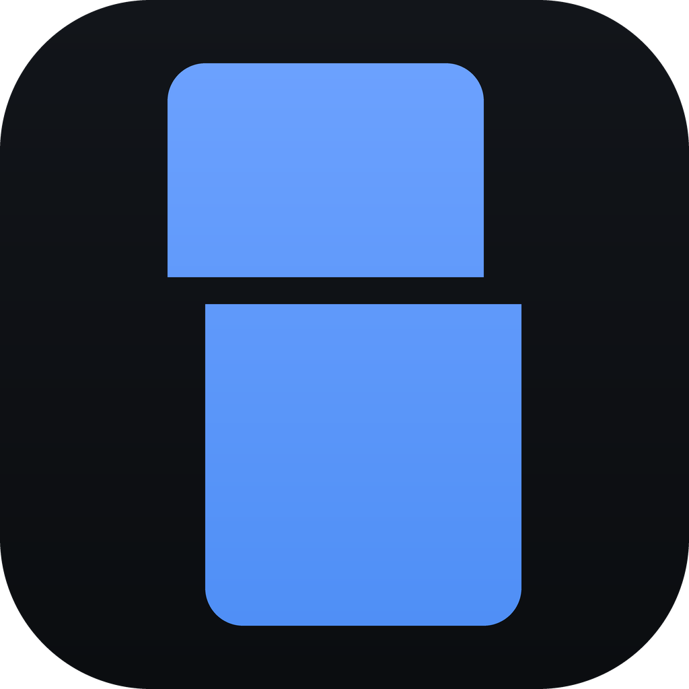

# Editbay

A free, local video editor.

## How to install

**Windows 11, 64-bit only.**

1. Download `Editbay.Setup.<version>.exe` from the latest [release](../../releases/latest).
2. Run it. Windows SmartScreen warns about an unrecognised app, because the installer is not
   code signed: click **More info**, then **Run anyway**.
3. Choose where it goes, or keep the folder it offers, and finish. Editbay is then in the
   Start menu and on the desktop.

Each release lists the installer's SHA-256, so you can check the download with
`certutil -hashfile Editbay.Setup.<version>.exe SHA256`.

## TL;DR

- A video editor for Windows: a multi-track timeline, transitions, layers, sound and captions.
- Free and open source. No account, no subscription, no watermark.
- Everything stays on your computer. Nothing you open is uploaded, and there is no telemetry.
- Quick with talking-head videos and screen recordings: it finds and cuts the pauses, writes
  captions from the speech, and keeps a face framed as it moves.
- Every action has a key, and every key can be changed.

---

Multi-track timeline, transitions, layers, sound, captions. It runs on your own machine, it
has no account and no subscription, and nothing you open is ever uploaded anywhere.

<!-- DEMO: replace this comment with the capture of a real edit being made -->
<!-- DEMO 2: a short capture of F1, a word typed, results from another category -->

> **Windows 11 x64 only.** There is no macOS or Linux build yet. See
> [Status](#status-and-limits) before you download.

## What it does

**Cuts.** A multi-track timeline with split, trim, ripple delete, ranges and snapping. Move
the playhead and press S to split, I and O to trim, Shift+Delete to lift a clip and close the
gap behind it. Up and Down jump between cuts on any track. Everything has a key and every key
can be changed.

**Turns a cut into a transition.** Thirty for picture, from a dissolve to a dip to black to a
push, a spin or a flash, and three for sound. Drag either end to change its length, drag its body to slide it
across the cut. A cut with no spare footage still takes one, and says so rather than
pretending.

**Removes silence, and shows you the bill first.** Point it at a track and it finds every
pause, then tells you how much time you would get back before it touches anything. Keep or
drop each pause one at a time, or take the lot. On anything with talking in it, this is most
of the edit.

**Layers pictures.** Stack video tracks, put one recording over another, and lay them out as
picture in picture, a split, or a corner. If both pictures are already in one recording, as
with a wide OBS canvas, it will cut that canvas in two and lay it out for you.

**Changes the picture.** Looks and colour adjustments, blur over part of the frame, and a
background taken out, green, blue or any plain colour. Text with saved styles, shapes and
arrows, images and GIFs, and an effects folder of your own, with the free packs it points you
to and the credits each export needs.

**Follows a face.** Cut a wide recording down to a vertical short, press Follow face, and the
crop keeps the speaker in frame with a few smooth pans you can then adjust. The face is found
on your machine.

**Frames the shot.** Drag a box over the source to choose what fills the frame, and drag the
picture in the output to place it. Four output shapes: vertical 1080x1920, landscape
1920x1080, square, and a handoff shape that keeps source resolution for feeding into another
tool.

**Handles sound.** Separate audio tracks linked to their picture, per-clip volume you can type
exactly, mute, solo and lock per track, loudness metering, voice over recording straight
into a track, music ducked under the voice, and a voice enhance and noise clean up that run
offline. The preview has its own volume that changes nothing about the export.

**Writes captions, on your machine.** The speech runs through whisper locally. No API key, no
upload, no per-minute bill. Fix the words, retime them, change where a line breaks, restyle
them, burn them in.

**Keeps several cuts in one project.** Sequences let you hold a vertical cut and a landscape
cut of the same sources side by side, and every crop is laid out again when you change shape.

**Expects difficult footage.** Variable frame rate screen recordings, HEVC off a phone, 4K
with rotation metadata, three different frame rates on one timeline. Sorted out on import
rather than breaking your cut two hours later.

**Knows where OBS puts things.** It reads OBS's own settings to find your recording folder,
so your newest capture is on the start screen with nothing to configure.

Also: markers, coloured clip marks, a skimmable source bin, an overview strip, autosave with
crash recovery, and a project that reopens exactly where you left it. `Ctrl+K` searches every
action in the app.

## What it does not do

This is deliberate, and it is most of why it is quick to use and quick to learn.

No LUTs or full colour grading: there are looks and a few colour adjustments, not a grading
suite. No speed ramps or time remapping. No plugins. Nothing that needs a render before you
can watch it back.

This list used to be longer, and said no transitions, no effects, no keyframes and no filters.
All of those went in against it, so it now says only the things that have held. Take it as a
description of the tool rather than a promise about it.

## What it sends over the network

Two requests, in the entire lifetime of the application:

1. The whisper program, once.
2. The English speech model, once, about 540 MB.

Both happen only if you ask for captions, and both are checked against a SHA-256 recorded in
the source before anything runs them. There is no telemetry, no account, no update check and
no cloud render queue. If you never use captions, Editbay never opens a socket. The face model for Follow face
ships with the app, so it downloads nothing. The one other way out is a link: **Get free
assets** opens a pack's page in your browser, and Editbay itself fetches nothing from it.

## Install

See [How to install](#how-to-install) at the top. The installer is not code signed because a
signing certificate costs money this project does not have, which is why SmartScreen warns.

## Build from source

Node 22.12 or newer.

```
git clone https://github.com/ZazaGdev/editbay.git
cd editbay
npm install
npm run dev
```

`npm install` downloads ffmpeg and ffprobe, which do the encoding: one pinned gyan.dev build,
checked against its SHA-256, into `vendor/ffmpeg`.

To produce an installer:

```
npm run dist
```

## Tests

```
npm run typecheck   types only
npm test            unit tests, pure logic
npm run test:e2e    the real pipeline against generated footage
npm run test:ui     the real app, clicked by a driver (builds first)
npm run test:smoke  the real pipeline against your own recordings
npm run test:relevant  only the tests a change can affect
```

The end-to-end suite generates its own video with the bundled ffmpeg, so a fresh clone runs
the whole thing with nothing to set up. The smoke suite is the only one that needs your own
files, and it skips itself when it cannot find any.

## Using it

**Press `F1`.** The tutorials are built into the app: short entries in eight categories, with
one search box across all of them, so you type what you are trying to do rather than going to
look for a video about it.

They are also [readable here](docs/tutorials/), because they are plain Markdown files rather
than something locked inside the app. Improving one is a pull request against a text file.

In the app, `Ctrl+/` is the full key list and `Ctrl+K` finds any action by typing a few letters
of it.

## For agents

An agent can make a rough cut without driving the window. The command line measures the
recordings and writes a project with Editbay's own editing code, and the project opens in the
app like one made by hand. Each command prints one JSON object on stdout, `ok: true` with what
it found or `ok: false` with why not, and exits non-zero when it refuses.

```
npm run --silent cli -- probe <files...>
npm run --silent cli -- sync <files...> [--track N]
npm run --silent cli -- transcribe <file> [--track N] [--from S] [--to S] [--window S]
npm run --silent cli -- pauses <file> [--track N]
npm run --silent cli -- frames <file> <seconds...> --out <dir>
npm run --silent cli -- build <edit-list.json> --out <project.editbay>
npm run --silent cli -- open <project.editbay> [--app <Editbay.exe>]
```

**Build it first, and again after every pull:** `npm run cli:build`. `npm run cli` only runs
the built `out/cli/editbay-cli.cjs`, so several calls can run at once; a rebuild replaces the
file whole, never under a call that is reading it.

From another folder, point npm at this repository with `--prefix`. Relative paths are then
taken from the folder you are in, not from the repository:

```
npm --prefix C:/path/to/editbay run --silent cli -- probe "D:/OBS-recordings/take.mkv"
```

`--silent` keeps npm's own banner off stdout, so what comes back is only the JSON;
`node out/cli/editbay-cli.cjs` is the same tool. Audio tracks are counted from 0; `sync
--track` picks the first file's track and the other files are heard on their first.
`transcribe` uses the speech engine the app downloads, so make captions once in Editbay first.
It listens a stretch between pauses of 2 s or more at a time, so a long recording does not
send whisper into a loop, and lists in `suspect` any stretch whose words still repeat one
phrase over and over. `build` reads an edit list, described in
[docs/edit-list.md](docs/edit-list.md): version 2 lays several recordings end to end as reels,
with shots that switch a reel to the camera half or hide the corner for a stretch. It refuses
anything it cannot honour with the entry named, and never writes over a file.

## How this was built

Every piece of work in the project started from a short plan document: what it was for, what
was explicitly out of scope, which files it touched, how to verify it and what could go wrong.
Those plans, and the session handovers written alongside them, stay in the private working
repo; this one gets the code, the tests and the user docs on each release.

If you contribute, [CONTRIBUTING.md](CONTRIBUTING.md) explains the convention: work starts
with a plan file.

## Status and limits

Version 1.0. It works, it is used daily, and it has rough edges.

- **Windows 11 x64 only.** A macOS build needs a different whisper binary, notarisation, a
  replacement for the Windows registry file association and a different way to find
  recordings. Help welcome.
- **English captions only.** The bundled model is `medium.en`. Another language will produce
  nothing useful.
- **The installer is unsigned**, so expect a SmartScreen warning.
- **The first captions cost 540 MB** of download, once, shared by every project afterwards.
- **No full grading, LUTs or speed ramps**, by design. See above.

## Licence

Editbay's own source is **MIT**. See [LICENSE](LICENSE).

The **installer is a different matter**. It bundles an ffmpeg build that includes x264, which
is GPL-3.0, so the installer as a combined work is conveyed under GPL-3.0. Editbay does not
link ffmpeg, it runs it as a separate process, which is why the source can be MIT while the
distributable is not.

[THIRD-PARTY-NOTICES.md](THIRD-PARTY-NOTICES.md) has the full reasoning, every version, and
where to get the corresponding source. The installed app carries the same in its `licences`
folder.
